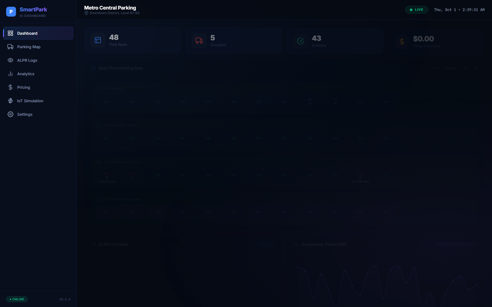
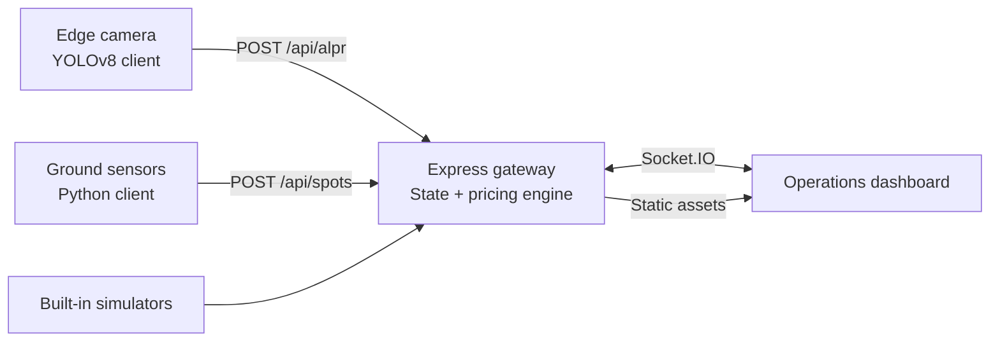

<div align="center">

# SmartPark AI

### Real-time Edge AI and IoT smart parking simulation

Monitor 48 parking spaces, stream simulated ALPR events, visualize occupancy, and explore demand-based pricing from a responsive operations dashboard.

[](https://nodejs.org/)
[](https://expressjs.com/)
[](https://socket.io/)
[](https://www.python.org/)
[](https://github.com/Aman10n/SmartParking/actions/workflows/ci.yml)

</div>



## Overview

SmartPark AI is a simulation-first smart parking platform that demonstrates how edge vision, ground sensors, a cloud gateway, and a live operator dashboard can work together. The default experience runs entirely on one machine: a Node.js gateway generates realistic telemetry and broadcasts every change to connected dashboards over Socket.IO.

The repository also includes optional Python clients for experimenting with an external YOLOv8 vehicle-detection pipeline and virtual IoT sensors. No physical hardware or trained license-plate OCR model is required for the demo.

## Highlights

- **Live occupancy map** — 48 spaces across VIP, standard, and EV charging zones.
- **Real-time telemetry** — incremental updates delivered over Socket.IO without page reloads.
- **ALPR event simulation** — randomized entry and exit events with plate and vehicle metadata.
- **Demand-based pricing** — a live quadratic surge model driven by current utilization.
- **Operations controls** — trigger events, force peak pricing, and simulate device outages.
- **Responsive interface** — a polished dark dashboard for desktop, tablet, and mobile.
- **External ingestion APIs** — REST endpoints for independent camera and sensor processes.
- **Deployment-ready server** — Express serves both the dashboard and the telemetry gateway.

## Architecture



The server keeps the facility state in memory, recalculates pricing when occupancy changes, and broadcasts compact updates to all connected clients. Built-in simulators make the full flow observable immediately after startup.

## Quick start

### Requirements

- [Node.js](https://nodejs.org/) 18 or newer
- npm 9 or newer

### Run locally

```bash
git clone https://github.com/Aman10n/SmartParking.git
cd SmartParking
npm ci
npm start
```

Open [http://localhost:3000](http://localhost:3000). Telemetry begins automatically after two seconds.

### Quality checks

```bash
npm run check
npm test
```

The smoke test starts the application on an isolated port and verifies the dashboard, health endpoint, valid telemetry ingestion, and invalid-payload rejection.

## Using the dashboard

The **IoT Simulation** view provides controls for common operational scenarios:

| Control | Behavior |
| --- | --- |
| Vehicle entry | Generates an occupied-space ALPR event |
| Vehicle exit | Generates a free-space ALPR event and a simulated fee |
| Force surge | Pins the pricing multiplier to its configured maximum |
| Camera disconnect | Pauses simulated camera and sensor telemetry |

Keyboard shortcuts: press `E` for an entry event or `X` for an exit event.

## Telemetry API

### Health check

```http
GET /api/health
```

### Submit an ALPR event

```http
POST /api/alpr
Content-Type: application/json

{
  "spot": "A01",
  "direction": "ENTRY",
  "plate": "KA 01 AB 1234",
  "vehicleType": "Sedan",
  "timestamp": 1767225600000
}
```

### Submit a ground-sensor update

```http
POST /api/spots
Content-Type: application/json

{
  "spot": "A01",
  "status": "occupied",
  "battery": 97.4,
  "timestamp": 1767225600000
}
```

Requests with an unknown space or invalid state are rejected with HTTP `400`.

## Optional Python telemetry clients

The normal demo does not require Python. To run the standalone clients against a local gateway:

```bash
# Terminal 1 — application gateway
npm start

# Terminal 2 — virtual ground sensors (standard library only)
python iot-sensors/virtual_sensors.py

# Terminal 3 — optional YOLOv8 vehicle-detection client
python -m venv .venv
# Windows: .venv\Scripts\activate
# macOS/Linux: source .venv/bin/activate
pip install -r edge-ai/requirements.txt
python edge-ai/main.py
```

The YOLOv8 client performs real vehicle detection on a sample frame. License-plate text remains simulated because this project does not ship a trained OCR/ALPR model.

## Configuration

| Variable | Default | Purpose |
| --- | --- | --- |
| `PORT` | `3000` | HTTP and Socket.IO port |
| `ALLOWED_ORIGIN` | Same origin | Optional browser origin allowed for cross-origin Socket.IO connections |
| `DISABLE_SIMULATORS` | `false` | Set to `true` when supplying only external telemetry |

Facility capacity, base rate, and maximum surge are defined in `server/server.js`.

## Project structure

```text
SmartParking/
├── .github/workflows/ci.yml     # Automated syntax and smoke checks
├── css/style.css                # Responsive dashboard styling
├── docs/                        # Repository media
├── edge-ai/
│   ├── main.py                  # Optional YOLOv8 telemetry client
│   └── requirements.txt
├── iot-sensors/
│   ├── virtual_sensors.py       # Optional virtual ground sensors
│   └── requirements.txt
├── js/app.js                    # Dashboard state and Socket.IO client
├── scripts/smoke-test.js        # End-to-end application smoke test
├── server/server.js             # Express, Socket.IO, pricing, simulators
├── index.html                   # Dashboard markup
└── package.json                 # Application scripts and dependencies
```

## Deployment

The application can run on any Node.js host that supports WebSockets.

For Render, Railway, or a similar platform:

- **Build command:** `npm ci`
- **Start command:** `npm start`
- **Health-check path:** `/api/health`
- **Runtime:** Node.js 18+

Because facility state is stored in memory, restarting or scaling the process resets the demo state. A production deployment should use persistent storage and a shared event broker.

## Production roadmap

- Persist parking sessions and revenue in PostgreSQL.
- Add authenticated operator and device identities.
- Replace generated plates with a trained OCR/ALPR pipeline.
- Store historical telemetry for genuine forecasting and analytics.
- Add payment-provider integration and audited billing workflows.
- Introduce device health monitoring, rate limiting, and structured logging.

## Scope

SmartPark AI is an engineering demonstration and portfolio project. Sensor readings, license plates, revenue, charts, and predictive labels shown in the interface are simulated unless an external telemetry source is connected.

---

<div align="center">
Built by <a href="https://github.com/Aman10n">Aman10n</a>
</div>
